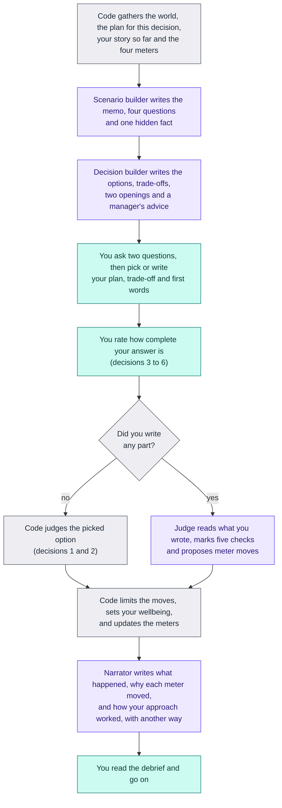
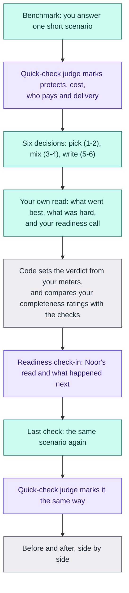

# The Leadership Game: system diagrams

How one play-through works, and who does what at each step. Colors: **teal is you (the player)**, **purple is AI**, **gray is code**.

## One decision

## The whole game

## Where each call runs

| Step | What it does | Model tier | Hosted link uses |
|---|---|---|---|
| Scenario builder | The memo, questions and a hidden fact | default | Claude Sonnet 5.5 |
| Decision builder | Options, trade-offs, openings, advice | default | Claude Sonnet 5.5 |
| Judge | Marks your written answer and proposes meter moves (decisions 3 to 6) | default | Claude Sonnet 5.5 |
| Narrator | The debrief after each decision | quick | Claude Haiku 5.5 |
| Readiness check-in | Noor's read and what happened next | default | Claude Sonnet 5.5 |
| Quick-check judge | The benchmark and the last check | quick | Claude Haiku 5.5 |

About 25 AI calls make one game. On claude.ai, claude.ai chooses the model for each tier; on the hosted link, a small relay server (a Cloudflare Worker) sends each call to the model above.
