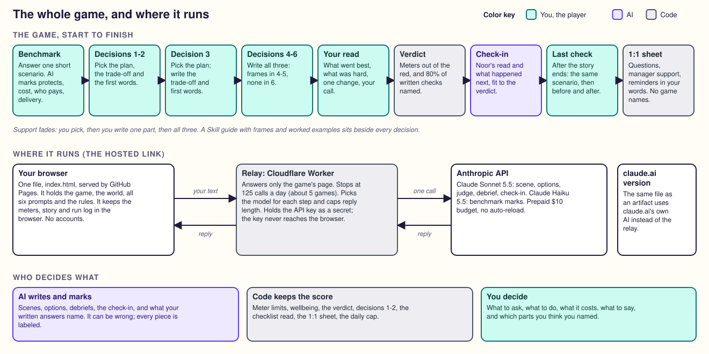
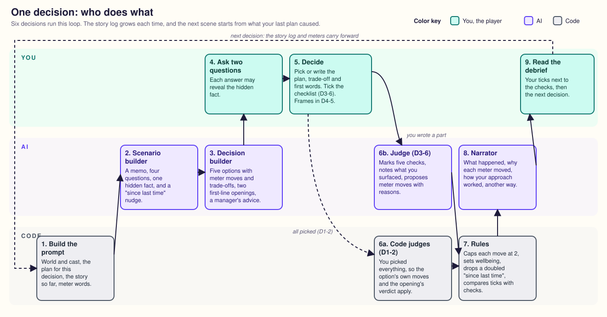

# How The Leadership Game works

Colors: **teal is you**, **purple is AI**, **gray is code**.

## The whole game, and where it runs

## One decision: who does what

**Reading it**
- **Every decision runs the same loop.** What changes is how much you write: decisions 1–2 you pick, decision 3 you write the trade-off and first words, decisions 4–6 you write all three.
- **When you only pick (decisions 1–2), code judges** from the option itself. When you write anything, the AI judge marks five checks: protects, cost, who pays, plan, delivery.
- **AI proposes and code decides.** The judge suggests meter moves; code caps them, sets wellbeing, and keeps the completeness read that feeds the verdict and the 1:1 sheet.
- **The loop carries forward.** The story log and meters go into the next scene, so it starts from what your last plan caused.

Diagram source: `docs/diagrams/make_diagrams.py`.
