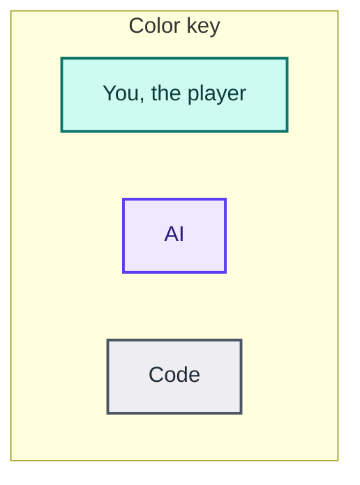
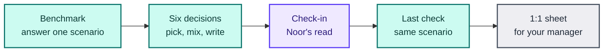
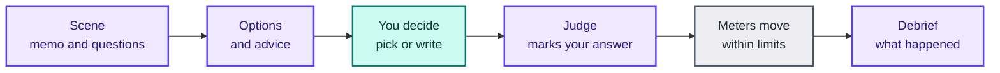

# How The Leadership Game works

## The whole game

## One decision

**In plain words**
- **AI writes**: the scene, the options, the debrief and the check-in. It also marks what your written answers name.
- **You decide**: you ask two questions, then pick or write your plan, trade-off and first words.
- **Code keeps the score**: it limits how far the meters move, sets your wellbeing and the readiness verdict, and judges decisions 1 and 2, where you pick instead of write.

| AI step | Model on the hosted link |
|---|---|
| Scene, options, judge, check-in | Claude Sonnet 5.5 |
| Debrief, benchmark marks | Claude Haiku 5.5 (smaller and faster) |

About 25 AI calls make one game, at about $0.45.
